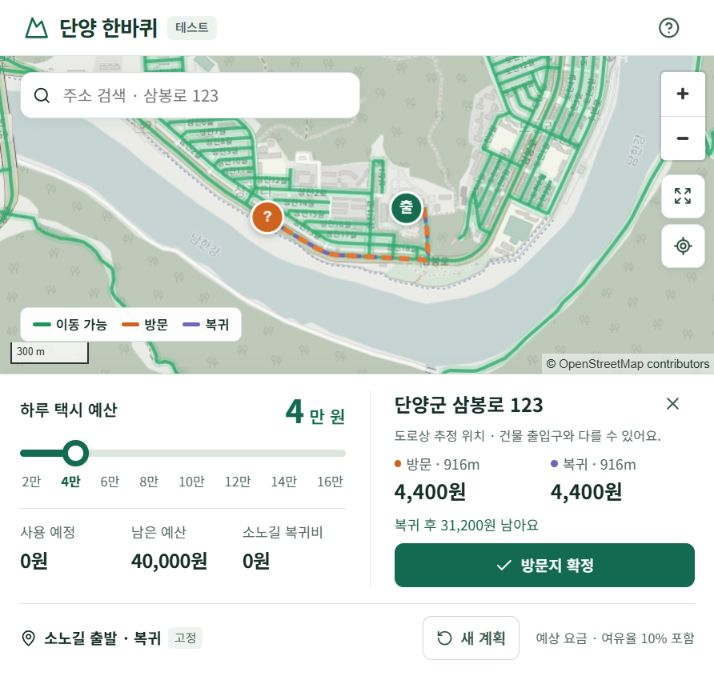

# 단양 한바퀴 — 택시 예산 여행

단양군 실제 SHP 도로망을 사용해 **다음 방문 비용 + 최종 도착 비용**이 예산 안에 들어오는 도로를 표시하는 정적 웹앱입니다. React · TypeScript · Vite · MapLibre GL JS로 구현했습니다. 서비스 실행 시 API 서버, Python, 데이터베이스, API 키가 필요하지 않습니다.



## 바로 실행

Node.js **22.22 이상인 22 LTS 버전** 또는 **24.22.1 이상**을 권장합니다. 프로젝트 폴더에서 실행하세요.

```powershell
npm ci
npm run dev
```

터미널에 표시되는 주소(기본 `http://127.0.0.1:5173/`)를 엽니다. 이 작업 폴더에는 의존성과 `dist/` 빌드 결과가 이미 생성되어 있습니다. `start-local.cmd`를 실행해도 개발 서버가 시작됩니다. 종료는 터미널에서 `Ctrl+C`입니다.

```powershell
npm test
npm run build
npm run preview
```

`dist/index.html`을 파일 탐색기에서 직접 열면 Worker와 데이터 로딩이 차단될 수 있습니다. `npm run preview` 또는 정적 웹 호스팅으로 열어야 합니다.

**이 PC의 빌드 환경:** 기본 설치 Node 24.12.0에서 Vite 빌드가 네이티브 종료 코드 `0xC0000409`로 중단되는 현상을 확인했습니다. 기존에 설치되어 있는 Node 24.22.1에서는 동일 소스가 정상 빌드되었습니다. 최신 LTS Node로 업데이트하면 표준 명령을 이용할 수 있습니다. 시스템 설치를 변경하지 않았습니다. 현재 PC에서 대체 런타임으로 빌드하려면:

```powershell
.\scripts\build-windows.ps1 -NodePath 'C:\Users\user\.cache\codex-runtimes\codex-primary-runtime\dependencies\node\bin\node.exe'
```

## 테스트 버전 사용 방법

모바일과 PC 모두 **지도 위 / 대시보드 아래** 구성입니다. 예산·요금·방문지 확정을 중심으로 화면을 간소화했습니다.

1. 소노길의 도로상 대표 위치에서 출발하고 같은 곳으로 복귀합니다. 특정 시설 정문이 아니며 위치 변경은 제공하지 않습니다.
2. 슬라이더를 드래그해 **20,000~160,000원, 20,000원 간격**으로 선택합니다. 기본값은 40,000원입니다. 키보드 방향키도 지원합니다.
3. 지도를 누르거나 `삼봉로 123`, `상선암길 52-8`처럼 도로명주소로 검색해 방문·복귀 요금을 확인합니다. 주소 검색 결과는 **기초번호가 일치하는 도로 구간의 추정 위치**입니다. 초록 도로는 복귀 비용까지 예산 안에 드는 범위입니다.
4. **방문지 확정**을 누르면 이번 탑승 요금만 차감됩니다. 후보 조회는 예산을 차감하지 않습니다.
5. **되돌리기**, **소노길로 복귀**, **완료 취소**, **새 계획**으로 계획을 관리합니다. 방문 목록은 필요할 때 펼칩니다.

여유율은 기존 10%, 호출료는 미포함으로 고정했습니다. **경로 내보내기, 운임 설정, 출발·도착지 변경 기능은 화면에서 제거**했습니다. 이전 저장값이 고정 조건과 다르면 새 계획을 시작합니다. 확정 계획은 브라우저에 자동 저장됩니다.

예산 초과·복귀 불가 후보지는 확정할 수 없습니다. 예산을 줄여 기존 방문과 복귀 비용을 감당하지 못하면 부족액을 표시합니다. 현재 위치와 같은 지점은 중복 방문으로 추가하지 않습니다.

## GitHub Pages 배포

GitHub 업로드와 push는 사용자가 직접 진행합니다. 이 작업에서는 저장소 생성·커밋·push·실제 배포를 하지 않았습니다.

1. 이 폴더의 소스를 GitHub 저장소 `main` 브랜치에 업로드합니다.
2. 저장소 **Settings → Pages → Build and deployment → Source**를 **GitHub Actions**로 선택합니다.
3. `.github/workflows/deploy.yml`이 테스트, 빌드, 하위 경로 검사를 실행한 뒤 `dist/`를 배포합니다.
4. **Actions → Deploy to GitHub Pages**에서 성공 여부와 배포 주소를 확인합니다. 수동 재실행도 가능합니다.

일반 프로젝트 저장소는 `https://사용자명.github.io/저장소명/`에서 서비스됩니다. `vite.config.ts`의 `base: './'`와 상대 데이터 URL로 저장소 이름 변경에도 대응합니다. GitHub의 기본 브랜치가 `main`이 아니면 워크플로의 `branches`를 수정하세요.

Git에 포함할 파일: `src/`, `public/`, `scripts/`, `tests/`, `docs/`, `.github/`, `package.json`, **`package-lock.json`**, Vite/TypeScript 설정, `README.md`, `requirements.txt`.

`.gitignore`는 `node_modules/`, `dist/`, 캐시, 테스트 화면과 기존 원본 ZIP·`데이터/`를 제외합니다. 전처리된 **`public/data/`는 반드시 포함**해야 합니다. 원본 SHP는 데이터 갱신용으로 로컬에 보관하며, 배포 시 Python 전처리를 다시 돌리지 않습니다.

배포 전 하위 경로 검증:

```powershell
npm run build
node scripts/check-pages.mjs
```

GitHub Pages와 같은 하위 경로에서 로컬로 확인하려면:

```powershell
node scripts/serve-dist.mjs
# http://127.0.0.1:4173/danyang-taxi/
```

두 서버 스크립트는 개발·검증 전용이며 배포 파일에 포함되지 않습니다.

## 데이터와 전처리

입력은 `데이터/단양군경계.shp`, `데이터/단양군도로.shp`, `데이터/단양군도로명기초구간.shp`와 각각의 `.shx`, `.dbf`, `.prj`, `.cpg`입니다. 원본을 수정하지 않습니다. 추가된 두 데이터 중 기초구간만 서비스에 적용했습니다.

### 주소 검색에 기초구간을 선택한 이유

출입구 14,873개는 좌표와 `BUL_MAN_NO`, `EQB_MAN_SN` 등 관리번호만 있고 **도로명·건물번호가 없습니다**. 이 번호들을 건물번호로 취급하지 않습니다. 출입구에 주소를 연결하려면 관리번호와 도로명주소를 잇는 건물/건물군 주소 자료가 추가로 필요합니다.

기초구간은 `SIG_CD + RDS_MAN_NO`로 기존 도로의 `RN`과 연결하며, `EVE_BSI_MN/SL`, `ODD_BSI_MN/SL`의 본번·부번을 검색합니다. 단양군 64,602개 객체(64,603개 선 부분), 632개 도로명의 128,922개 서로 다른 기초번호 조합을 포함합니다. 이는 건물 주소 수가 아닙니다. 인접 시군 5개 객체는 검색에서 제외했습니다. 주소 인덱스는 약 0.99MB gzip이며 브라우저에서 검색하므로 개발자 계정·외부 주소 검색 API 없이 GitHub Pages에서 실행됩니다.

- `충청북도 단양군 단양읍 삼봉로 123`, `삼봉로123`, 본번-부번을 지원합니다. 읍면별 주소 유효성은 검증하지 않습니다.
- 번호까지 입력하면 본번·부번이 정확히 일치하는 구간만 표시합니다. 없는 번호는 인접 번호나 도로 대표 위치로 대체하지 않습니다.
- 실제 선을 따라 잰 중점을 사용합니다. 건물 존재나 좌우 출입구 위치를 확인한 결과가 아닙니다. 기초번호와 건물번호가 항상 일치한다고 가정하지 않습니다.
- 같은 번호가 여러 구간에 있으면 후보를 나누어 표시합니다. 검색 결과의 구간 길이와 선택 후 지도를 확인하세요.
- 선택한 위치는 원본의 같은 도로에만 연결해 경로를 계산합니다. 추정 표시와 주소명은 방문 확정·새로고침 후에도 유지됩니다.
- 도로명만 입력하면 기존 도로 대표 위치 검색도 가능합니다. 상호명·지번·동호수 검색은 제공하지 않습니다.

| 항목 | 확인 결과 |
|---|---|
| 좌표계 | EPSG:5179, 미터 |
| 경계 | Polygon 1개 |
| 도로 | 2,578개, LineString 2,570개 / MultiLineString 8개 |
| 속성 인코딩 | 경계 UTF-8 / 도로 CP949 |
| 생성 그래프 | 노드 5,099개 / 엣지 5,680개 |
| 연결 성분 | 30개, 최대 성분 4,979개 노드 |
| 그래프 선형 총길이 | 약 1,281.898km, 중복 선형을 포함할 수 있는 구간 합계 |
| 그래프 파일 | 약 1.32MB gzip, 해제 시 약 4.38MB |

일반 Python 3.10 이상 환경:

```powershell
python -m venv .venv
.\.venv\Scripts\python -m pip install -r requirements.txt
.\.venv\Scripts\python scripts/inspect_shp.py --input 데이터
.\.venv\Scripts\python scripts/build_graph.py
.\.venv\Scripts\python scripts/build_address_index.py
```

현재 PC의 QGIS 3.40.12에 설치된 Python/공간 라이브러리를 활용할 수도 있습니다.

```powershell
.\scripts\qgis-python.ps1 scripts/inspect_shp.py
.\scripts\qgis-python.ps1 scripts/build_graph.py
.\scripts\qgis-python.ps1 scripts/build_address_index.py
```

다른 QGIS 버전이면 `qgis-python.ps1`의 `$qgisRoot`와 Python 경로를 조정하세요. `build_graph.py --roads ... --boundary ... --output public/data`로 입력 경로를 지정할 수 있습니다.

전처리 결과:

- `road-graph.json.gz`: 라우팅용 그래프. 노드는 `[x,y,lng,lat]`, 엣지는 끝점·미터 길이·방향·도로명 인덱스·선형을 가집니다.
- `road-display.geojson.gz`: 지도 표시용 도로.
- `danyang-boundary.geojson`: 경계, EPSG:4326.
- `road-search.json`: 실제 `RN` 속성에서 추출한 도로명과 대표 위치.
- `address-index.json.gz`: 기초구간의 번호·도로명·추정 위치. 그래프를 갱신하면 `build_address_index.py`도 실행해야 합니다.
- `address-metadata.json`: 주소 데이터의 연결 키, 포함·제외 수, 열 정의, 중복 번호와 한계.
- `network-metadata.json`: 출처, 크기, 연결성, 해시, 가정과 한계.
- `fare-config.json`: 전처리와 별도로 관리하는 운임 설정.
- `topology-repairs.json`: 보정·보류 후보의 원본 행 번호, 도로명, 간격, 전후 접촉 좌표와 판정 기록.

재생성 후 `npm test`, `npm run build`를 실행하고 변경된 `public/data/`를 업로드합니다. 원본·전처리 코드·허용 거리를 그래프 버전 해시에 포함합니다. 하나라도 바뀌면 이전 계획은 자동 복원하지 않습니다. 연결 보정 회귀 검사는 `.\scripts\qgis-python.ps1 tests/test_topology.py`로 실행합니다.

## 정확도와 사용 범위

**이 앱은 제공된 도로망과 명시된 운임 모델에 따른 계획 도구입니다. 실차 내비게이션이나 확정 견적은 아닙니다.**

원본에는 일방통행, 회전 제한, 고도, 차량 통행 제한이 없습니다. 따라서 SHP 구간은 양방향으로 가정하며 차량 접근 가능성을 검증한 네트워크로 표현하지 않습니다. 계산 엔진 자체는 방향 그래프를 지원하고 가상 일방통행 시나리오로 검증했습니다.

기존 공유 꼭짓점과 **0.50m 이내 끝점 접촉**을 공통 노드로 통합합니다. 끝점과 선 중간의 접촉은 대상 선도 분할하며, 연쇄 병합이 허용 범위를 넘지 않도록 제한합니다. 선 내부끼리 교차하는 곳은 자동 연결하지 않습니다. 고속도로·자전거·등산 명칭 도로의 새 간격 연결은 검토 대상으로 남깁니다. 보정 후 연결 성분은 36개에서 30개가 됐습니다. 이 결과는 지리적 근접에 따른 보정이며 실제 차량 통행 확인을 대신하지 않습니다. [보정 내역](public/data/topology-repairs.json)에 1cm 초과 접촉의 병합 200건과 보류 후보 7건을 기록했습니다.

단양군 내부 자료만 있으므로 인접 시·군을 경유하는 경로가 누락될 수 있습니다. `SIG_CD=43150`인 4개 원본 객체도 도형을 유지합니다. OSM은 배경지도로 사용하며 형상이 다른 도로를 자동 혼합하지 않습니다. 제한 정보를 확보하려면 검증된 방향/접근 데이터로 그래프를 다시 만들어야 합니다.

도로의 `ROAD_LT`는 분할 전 원본 전체 길이일 수 있어 운임에 사용하지 않습니다. 분할·0.35m 단순화한 EPSG:5179 선형 길이를 사용합니다. 지도 클릭은 가장 가까운 **도로 선분**에 투영하고, 선 중간의 실제 이동 부분만 계산합니다. 50m 이상 이격은 안내하고 500m 초과는 연결을 거절합니다. 도로까지의 보행 접근은 계산하지 않습니다.

운임의 공식 확인 범위와 상세 추정 규칙은 [운임·데이터 기준](docs/ASSUMPTIONS.md)을 참고하세요. 최신 개정 여부와 미터기 단수 처리까지 공식 검증이 끝난 모델로 오인하지 않도록 UI에도 안내합니다.

## 알고리즘과 성능

- Web Worker에서 최소 힙 Dijkstra를 수행합니다. 출발 방향과 최종 도착 방향의 역그래프를 각각 계산합니다.
- 선 중간 위치는 가상 연결 비용으로 처리하고, 같은 엣지에서 바로 이동하는 경로도 고려합니다. 자기 루프도 처리합니다.
- 이동 가능한 도로는 `요금(현재→점) + 요금(점→최종) ≤ 남은 예산`으로 판정합니다.
- 엣지 내부 최단거리 함수의 모든 **요금 변화 지점**을 분할해 각 구간을 판정합니다. 양끝이 예산 밖이어도 중간에 가능한 구간이 있으면 표시합니다. 단순 노드 샘플링이나 직선 반경이 아닙니다.
- 최대 8개의 최단거리 트리를 캐싱하며, 후보지만 바뀌면 기존 이동 가능 범위를 재사용합니다.
- 요청 번호와 입력 상태를 함께 확인해 오래된 Worker 응답이 최신 후보지나 확정 버튼을 덮어쓰지 못하게 합니다.
- 그래프와 지도 데이터를 분리하고 정적 gzip 파일을 브라우저의 `DecompressionStream`으로 해제합니다. 최신 Chrome/Edge/Firefox/Safari가 필요합니다.

이 PC의 테스트 런타임에서 실제 그래프 초기화 약 38ms, 2~16만원 시나리오의 영역 계산 약 20~33ms였습니다. 네트워크 다운로드·지도 렌더링을 제외한 한 번의 측정이며 기기와 환경에 따라 달라집니다. [검증 기록](docs/VALIDATION.md)에 검사 범위를 정리했습니다.

## 배경지도와 출처

배경지도는 [OpenStreetMap](https://www.openstreetmap.org/copyright)입니다. 저작자 표시를 지도에 유지하고 [OSM 타일 이용 정책](https://operations.osmfoundation.org/policies/tiles/)에 따라 화면에서 필요한 타일만 요청합니다. 오프라인 사전 다운로드나 프리페치는 하지 않습니다. 트래픽이 커지면 정책에 맞는 다른 OSM 기반 타일 서비스로 `src/components/MapView.tsx`의 소스를 교체하세요.

구현 참고: [MapLibre raster source](https://maplibre.org/maplibre-gl-js/docs/examples/add-a-raster-tile-source/), [Vite GitHub Pages 배포](https://vite.dev/guide/static-deploy.html#github-pages).
